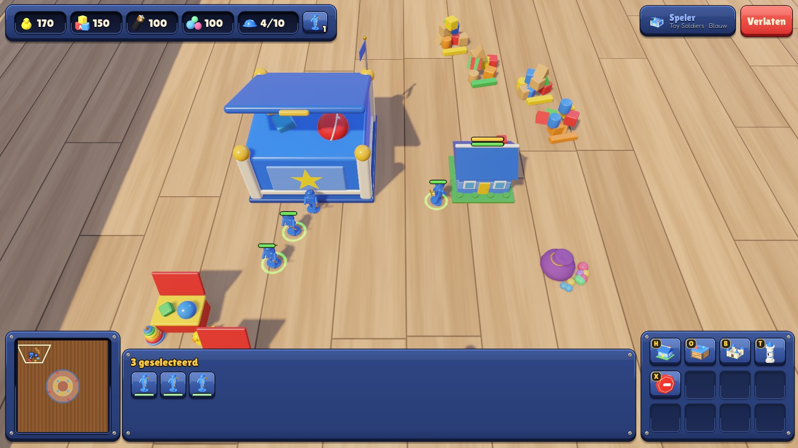
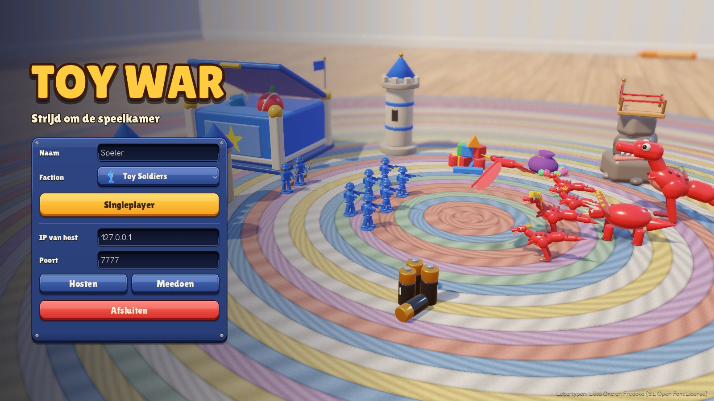
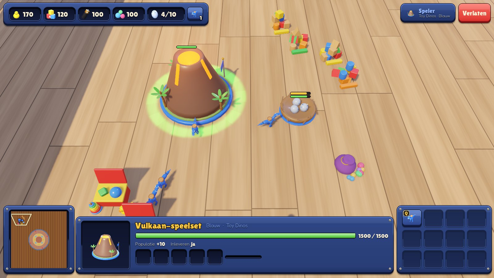

# Toy War RTS

Een realtime strategiespel in de stijl van Age of Empires, maar dan met speelgoed.
Twee factions vechten om de kinderkamer: **Toy Soldiers** (opwindsoldaatjes) en **Toy Dinos** (plastic dino's).
Gemaakt in **Godot 4.3**. Tot 4 spelers (Blauw, Rood, Groen, Geel), ook over het netwerk.





## Starten

1. Installeer [Godot 4.3](https://godotengine.org/download) (standaardversie, niet .NET).
2. Open Godot, kies **Import** en selecteer `project.godot` in deze map.
3. Druk op **F5**.

### Multiplayer

- Eén speler kiest **Hosten**. Het menu toont zijn IP-adres. De poort is 7777 (UDP).
- De anderen vullen dat IP in en kiezen **Meedoen**.
- De host drukt op **Start spel** zodra iedereen in de lobby staat.
- Op hetzelfde netwerk werkt dit direct. Via internet moet de host UDP-poort 7777 openzetten (port forwarding) of een tool als Tailscale/ZeroTier gebruiken.

Twee vensters op één pc testen: in Godot via *Debug → Customize Run Instances* twee instances starten, of vanaf de command line:

```
godot --path . -- --host --autostart=2
godot --path . -- --join=127.0.0.1
```

## Besturing

| Actie | Knop |
|---|---|
| Selecteren | linkermuisknop (slepen voor een kader, Shift om toe te voegen) |
| Lopen / verzamelen / bouwen / aanvallen | rechtermuisknop op grond, bron, bouwwerk of vijand |
| Camera | WASD, pijltjes of muis tegen de rand; middelste muisknop slepen; klik/sleep op de minikaart |
| Units via de minikaart sturen | rechtsklik op de minikaart |
| Zoomen | scrollwiel |
| Naar je HQ | Spatie |
| Werkeloze worker | `.` of de knop bovenin |
| Gebouw plaatsen | H, O, B, T (met workers geselecteerd); Shift houdt de bouwmodus aan |
| Unit trainen | Q (met gebouw geselecteerd) |
| Verzamelpunt zetten | gebouw selecteren, rechtsklik (op een bron: nieuwe workers gaan verzamelen) |
| Stop / annuleren | X / Esc |

## Spelontwerp (Toy Soldiers)

**Resources**

| Resource | Bron op de kaart | Gebruik |
|---|---|---|
| Plastic | Speelgoedkist | units (zoals food) |
| Blokjes | Blokkenstapel | gebouwen (zoals wood) |
| Batterijen | Batterijpak | geavanceerde units en upgrades (zoals gold) |
| Knikkers | Knikkerzak | verdediging (zoals stone) |

Workers lopen naar een bron, pakken 10 stuks en brengen die naar de dichtstbijzijnde Speelgoeddoos of Opslagkist.

**Gebouwen**

| Gebouw | Kost | Doet |
|---|---|---|
| Speelgoeddoos (HQ) | start | inleverpunt, traint workers, +10 pop |
| Opslagkist | 100 Blokjes | extra inleverpunt |
| Lego-huisje | 50 Blokjes | +10 pop |
| Barak | 150 Blokjes | traint infanterie |
| Wachttoren | 50 Blokjes, 100 Knikkers | schiet op vijandelijke units |

**Units**

| Unit | Kost | |
|---|---|---|
| Opwindsoldaatje | 50 Plastic | verzamelt en bouwt |
| Geweerschutter | 60 Plastic, 20 Batterijen | basis-infanterie |

## Faction 2: Toy Dinos



Zelfde 4 resources, maar een andere speelstijl: geen voertuigen, wel dieren die vanzelf genezen
(0,6 HP per seconde) en een vliegende verkenner.

**Gebouwen**

| Gebouw | Kost | Doet |
|---|---|---|
| Vulkaan-speelset (HQ) | start | inleverpunt, traint Mini-raptors, +10 pop |
| Nest (N) | 80 Blokjes | inleverpunt én +5 pop |
| Broedplaats (B) | 150 Blokjes | Velociraptor, Dilophosaurus |
| Fossielenlab (F) | 150 Blokjes, 100 Batterijen | Triceratops, Pteranodon, T-rex |
| Uitkijkrots (U) | 25 Blokjes, 100 Knikkers | schiet op vijandelijke units, groot bereik |

**Units**

| Unit | Kost | |
|---|---|---|
| Mini-raptor | 50 Plastic | worker, iets sneller dan het opwindsoldaatje |
| Velociraptor | 50 Plastic, 10 Batterijen | snel, goedkoop, melee |
| Dilophosaurus | 50 Plastic, 25 Batterijen | spuwt op afstand |
| Triceratops | 120 Plastic, 60 Batterijen, 2 pop | tank, dubbele schade tegen gebouwen |
| Pteranodon | 40 Plastic, 30 Batterijen | vliegende verkenner, vliegt over alles heen, valt niet aan |
| T-rex | 250 Plastic, 150 Batterijen, 4 pop | eindbaas |

Je kiest je faction in het hoofdmenu of in de lobby.

Alle getallen staan in `scripts/autoload/game_data.gd`. Een nieuwe faction toevoegen = een blok in
`FACTIONS` plus de units/gebouwen, en modellen in `entity.gd`.

## Hoe de code in elkaar zit

```
scripts/
  autoload/game_data.gd     alle speldata (kosten, HP, snelheid...)
  autoload/net.gd           lobby en ENet-verbinding
  main.gd                   hoofdmenu en lobby-UI
  game/game.gd              wereld, simulatie, netwerk-sync
  game/entity.gd            unit/gebouw/bron: netwerkstaat + animaties
  game/player_controller.gd selecteren, commando's, bouwen (met spookmodel)
  game/rts_camera.gd        camera (met lichte tilt-shift)
  game/hud.gd               game-UI: grondstoffen, selectie + 3D-portret, commandokaart
  visual/toy_mesh.gd        procedurele meshes met afgeronde randen (plastic look)
  visual/toy_mat.gd         materialen: glimmend plastic, metaal, knikkerglas, selectiering
  visual/toy_models.gd      alle 3D-modellen (units, gebouwen, bronnen, iconen)
  visual/room.gd            de kinderkamer: houten vloer, gevlochten kleed, licht, nabewerking
  visual/fx.gd              effecten: splinters bij een treffer, poef, mondingsvuur, stof
  ui/ui_skin.gd             UI-thema; panelen/knoppen worden bij het opstarten getekend
  ui/icons.gd               (autoload) iconen en portretten uit de echte 3D-modellen
  ui/minimap.gd             minikaart
  ui/menu_scene.gd          levend slagveldje achter het hoofdmenu
  debug/smoke_test.gd       geautomatiseerde test
  debug/showcase.gd         vitrine met alle modellen naast elkaar
```

**Graphics:** er zitten geen losse 3D-bestanden of plaatjes in het project. Alle modellen
worden in code opgebouwd uit afgeronde plastic onderdelen (`toy_models.gd`), en de iconen in de
interface zijn foto's van diezelfde modellen. Een model aanpassen = een paar regels in
`toy_models.gd`; het icoon verandert vanzelf mee.

**Netwerk:** de host is de baas (server-authoritative). Alleen de host draait de simulatie.
Spelers sturen commando's (`cmd_move`, `cmd_target`, `cmd_build`, `cmd_train`...) via RPC;
de host controleert ze (is dit jouw unit, heb je genoeg resources?) en stuurt 10× per seconde
een snapshot terug. Singleplayer gebruikt precies dezelfde route, dus wat in singleplayer werkt,
werkt ook online.

## Testen

```
godot --headless --path . -- --single --smoke-test
```

Speelt 30 seconden vanzelf (verzamelen, worker trainen, huisje bouwen) en eindigt met
`RESULTAAT: OK`. Voor multiplayer: start een host met `--host --autostart=2 --smoke-test`
en een client met `--join=127.0.0.1 --faction=dinos --smoke-test`.

Screenshots maken (vensterbaar, niet headless): voeg `--screenshot=pad.png` toe aan de
smoke- of gevechtstest. Extra opties: `--select=hq` (selecteer iets voor de foto),
`--place=barracks` (bouwmodus), `--menu-shot` (hoofdmenu) en `--showcase=units`
(of `buildings`, `resources`) voor een vitrine met alle modellen.

Gevechtstest voor de dino-regels (T-rex wint, Triceratops-bonus, vliegen, genezen):

```
godot --headless --path . -- --single --faction=dinos --combat-test
```

## Volgende stappen

- Pathfinding met een navmesh (nu lopen units recht en sturen ze simpel om obstakels heen)
- Meer Toy Soldiers-units: Bazooka, Sluipschutter, Speelgoedjeep, Speelgoedtank (Garage)
- Rotswand voor de Dinos en blokkenmuur voor de Soldiers
- Werkplaats met upgrades, blokkenmuren
- Fog of war, overwinning/verlies
- Geluid en muziek

## Credits

- Lettertypen [Lilita One](https://fonts.google.com/specimen/Lilita+One) (Juan Montoreano) en
  [Fredoka](https://fonts.google.com/specimen/Fredoka) (The Fredoka Project Authors), beide onder de
  SIL Open Font License 1.1. De licenties staan in `assets/fonts/`.
- Alle modellen, texturen, shaders en UI-onderdelen zijn zelf gemaakt (procedureel, in code).
