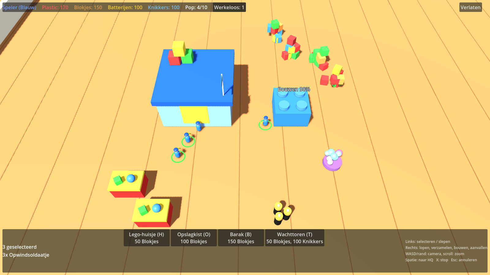

# Toy War RTS

Een realtime strategiespel in de stijl van Age of Empires, maar dan met speelgoed.
De eerste faction is **Toy Soldiers**: opwindsoldaatjes die een kinderkamer veroveren.
Gemaakt in **Godot 4.3**. Tot 4 spelers (Blauw, Rood, Groen, Geel), ook over het netwerk.



## Starten

1. Installeer [Godot 4.3](https://godotengine.org/download) (standaardversie, niet .NET).
2. Open Godot, kies **Import** en selecteer `project.godot` in deze map.
3. Druk op **F5**.

### Multiplayer

- Eén speler kiest **Hosten**. Het menu toont zijn IP-adres. De poort is 7777 (UDP).
- De anderen vullen dat IP in en kiezen **Meedoen**.
- De host drukt op **Start spel** zodra iedereen in de lobby staat.
- Op hetzelfde netwerk werkt dit direct. Via internet moet de host UDP-poort 7777 openzetten (port forwarding) of een tool als Tailscale/ZeroTier gebruiken.

Twee vensters op één pc testen: in Godot via *Debug → Customize Run Instances* twee instances starten, of vanaf de command line:

```
godot --path . -- --host --autostart=2
godot --path . -- --join=127.0.0.1
```

## Besturing

| Actie | Knop |
|---|---|
| Selecteren | linkermuisknop (slepen voor een kader, Shift om toe te voegen) |
| Lopen / verzamelen / bouwen / aanvallen | rechtermuisknop op grond, bron, bouwwerk of vijand |
| Camera | WASD, pijltjes of muis tegen de rand; middelste muisknop slepen |
| Zoomen | scrollwiel |
| Naar je HQ | Spatie |
| Werkeloze worker | `.` of de knop bovenin |
| Gebouw plaatsen | H, O, B, T (met workers geselecteerd); Shift houdt de bouwmodus aan |
| Unit trainen | Q (met gebouw geselecteerd) |
| Verzamelpunt zetten | gebouw selecteren, rechtsklik (op een bron: nieuwe workers gaan verzamelen) |
| Stop / annuleren | X / Esc |

## Spelontwerp (Toy Soldiers)

**Resources**

| Resource | Bron op de kaart | Gebruik |
|---|---|---|
| Plastic | Speelgoedkist | units (zoals food) |
| Blokjes | Blokkenstapel | gebouwen (zoals wood) |
| Batterijen | Batterijpak | geavanceerde units en upgrades (zoals gold) |
| Knikkers | Knikkerzak | verdediging (zoals stone) |

Workers lopen naar een bron, pakken 10 stuks en brengen die naar de dichtstbijzijnde Speelgoeddoos of Opslagkist.

**Gebouwen**

| Gebouw | Kost | Doet |
|---|---|---|
| Speelgoeddoos (HQ) | start | inleverpunt, traint workers, +10 pop |
| Opslagkist | 100 Blokjes | extra inleverpunt |
| Lego-huisje | 50 Blokjes | +10 pop |
| Barak | 150 Blokjes | traint infanterie |
| Wachttoren | 50 Blokjes, 100 Knikkers | schiet op vijandelijke units |

**Units**

| Unit | Kost | |
|---|---|---|
| Opwindsoldaatje | 50 Plastic | verzamelt en bouwt |
| Geweerschutter | 60 Plastic, 20 Batterijen | basis-infanterie |

Alle getallen staan in `scripts/autoload/game_data.gd`.

## Hoe de code in elkaar zit

```
scripts/
  autoload/game_data.gd     alle speldata (kosten, HP, snelheid...)
  autoload/net.gd           lobby en ENet-verbinding
  main.gd                   hoofdmenu en lobby-UI
  game/game.gd              wereld, simulatie, netwerk-sync
  game/entity.gd            unit/gebouw/bron + placeholder-modellen
  game/player_controller.gd selecteren, commando's, bouwen
  game/rts_camera.gd        camera
  game/hud.gd               resourcebalk, info, knoppen
  debug/smoke_test.gd       geautomatiseerde test
```

**Netwerk:** de host is de baas (server-authoritative). Alleen de host draait de simulatie.
Spelers sturen commando's (`cmd_move`, `cmd_target`, `cmd_build`, `cmd_train`...) via RPC;
de host controleert ze (is dit jouw unit, heb je genoeg resources?) en stuurt 10× per seconde
een snapshot terug. Singleplayer gebruikt precies dezelfde route, dus wat in singleplayer werkt,
werkt ook online.

## Testen

```
godot --headless --path . -- --single --smoke-test
```

Speelt 30 seconden vanzelf (verzamelen, worker trainen, huisje bouwen) en eindigt met
`RESULTAAT: OK`. Voor multiplayer: start een host met `--host --autostart=2 --smoke-test`
en een client met `--join=127.0.0.1 --smoke-test`.

## Volgende stappen

- Pathfinding met een navmesh (nu lopen units recht en sturen ze simpel om obstakels heen)
- Meer units: Bazooka, Sluipschutter, Speelgoedjeep, Speelgoedtank (Garage)
- Werkplaats met upgrades, blokkenmuren
- Fog of war, minimap, overwinning/verlies
- Echte modellen en geluid
